<div align="center">

<p>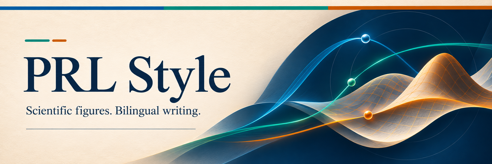</p>

<p><strong>让图更清晰，让论证更有力。</strong></p>

<p>为你的 AI agent 配备一套 PRL 风格的科研表达工具。<br>
从数据绘图、科学示意，到中英文写作、图注与审校。</p>

<p>可接入 <code>Codex</code> · <code>Claude Code</code> · <code>OpenCode</code> · <code>DeepSeek Harness</code></p>

<p>
  <a href="#一句话安装"><strong>一句话安装</strong></a> &nbsp;·&nbsp;
  <a href="#效果预览">看看效果</a> &nbsp;·&nbsp;
  <a href="https://github.com/tysun1209/prl-style/releases/latest">下载最新版</a> &nbsp;·&nbsp;
  <a href="#怎么使用">使用示例</a>
</p>

</div>

|  |  |  |  |
| :---: | :---: | :---: | :---: |
| 数据图、场图与多面板组合 | 按数据含义选色，附文献来源 | 1,022 幅图件的构图与用色观察 | 英文表达与中文写作规则 |

PRL Style 从 *Physical Review Letters* 的真实论文中提炼绘图、配色与写作经验，整理为 agent 可调用的规则、模板和脚本。提供数据、草稿或研究思路，即可开始。

## 效果预览

### 相同数据，使用前后

下面展示直方图、箱线图、热图、离散相图、曲线图和分组散点图。左侧为没用 skill，右侧为用了 skill，各按三行两列排列，对应位置使用相同数据和基础任务提示，完整原图按相同显示宽度呈现。前四类来自原有测试，曲线图和散点图补充 NOAA 和 Palmer Penguins 公开数据。重点观察字体、图例、配色、留白和坐标轴的变化。

[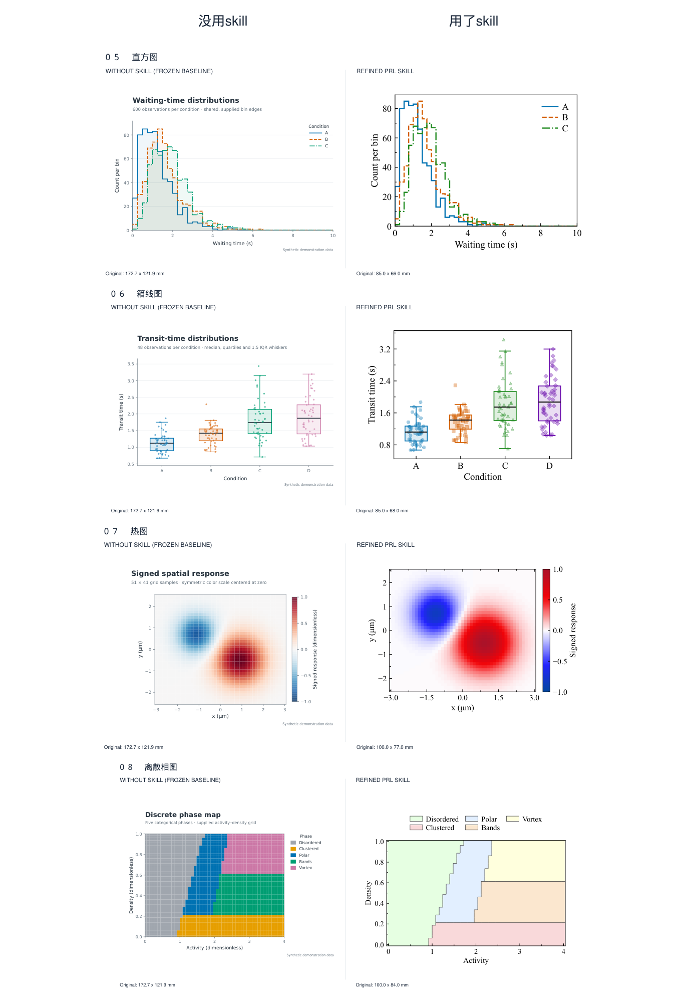](assets/showcase/skill-comparison.png)

### 从 PRL 图件中提取的配色

555 组配色覆盖类别、顺序、发散、循环和多色相色标，**每组均附文献出处**。绘图时按图型与数据含义自动选色，也可指定方案。下图展示其中 9 组。

[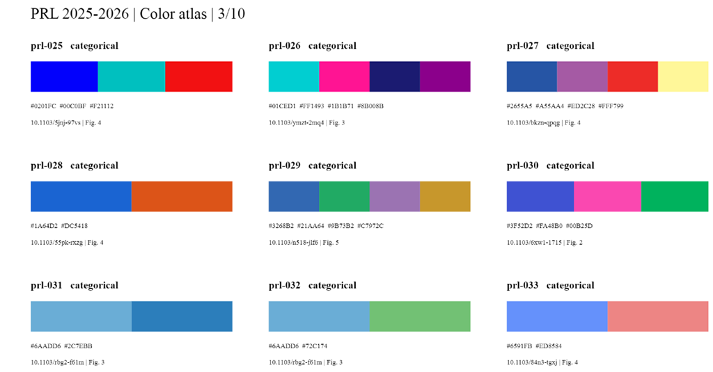](reports/prl-colors-2025-2026/palette-atlas.pdf)

[检索全部配色](reports/prl-colors-2025-2026/index.html) · [完整色卡 PDF · 555 组](reports/prl-colors-2025-2026/palette-atlas.pdf) · [配色选择与调用](references/prl-color-palettes.md)

[查看 291 篇文献、1,022 幅图件的提取与检索说明](references/visual-corpus.md)。

### 配色应用示例

下面展示配色在曲线与误差带、离散相图、连续场、正负场、填色等高线和参数扫描曲线中的使用效果。点击图片可查看完整尺寸。

[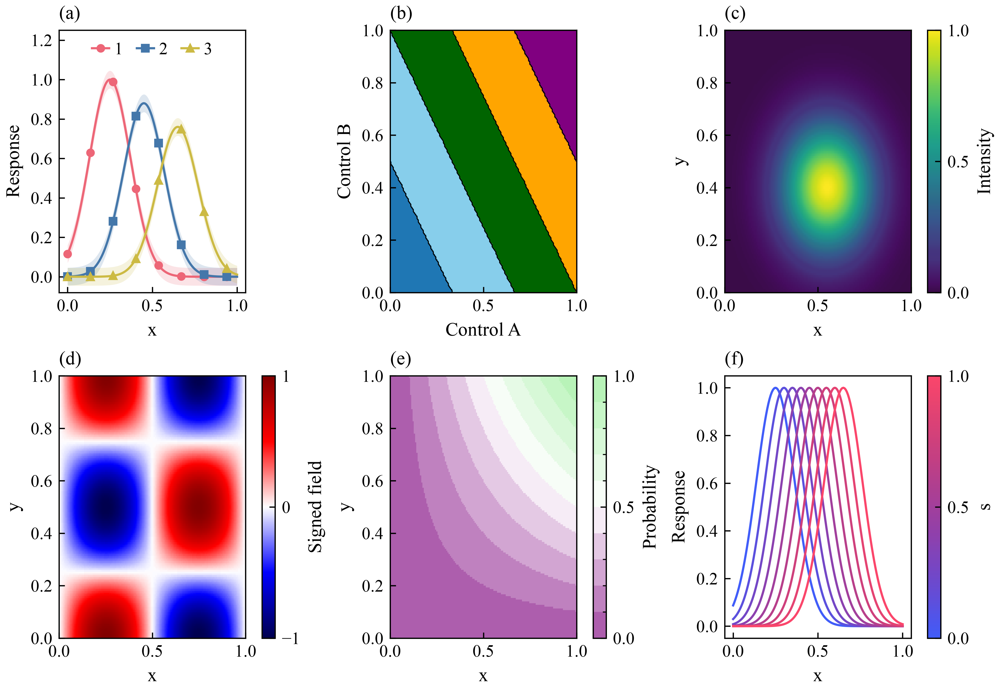](reports/prl-colors-2025-2026/usage-examples.png)

### 更多图型

支持 36 类图型，以下为部分示例，点击可查看原图。

| 误差带 | 流线场 | 粒子轨迹 |
| :---: | :---: | :---: |
| [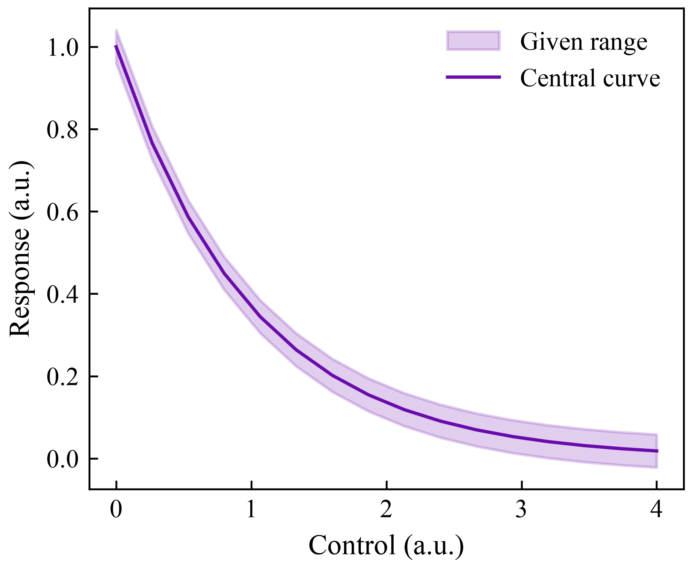](assets/showcase/uncertainty-band.png) | [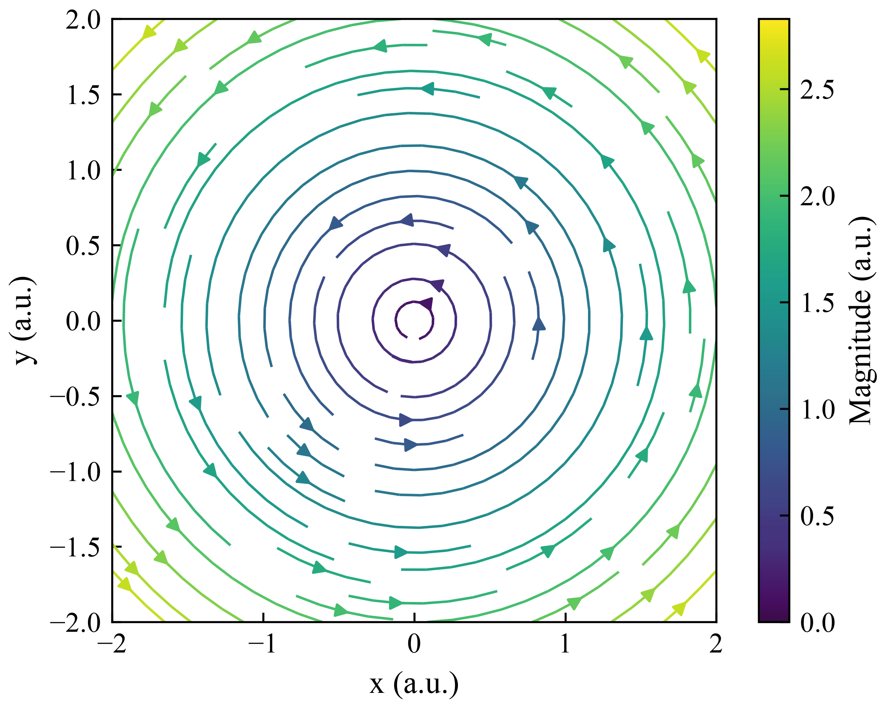](assets/showcase/streamlines.png) | [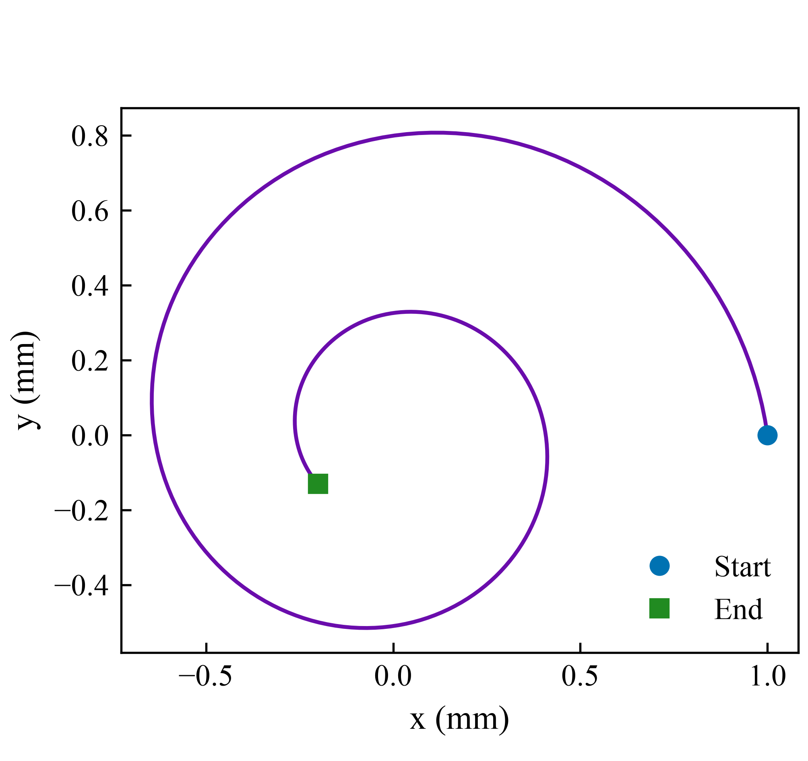](assets/showcase/trajectory.png) |

| 时空图 | 三维曲面 | 网络图 |
| :---: | :---: | :---: |
| [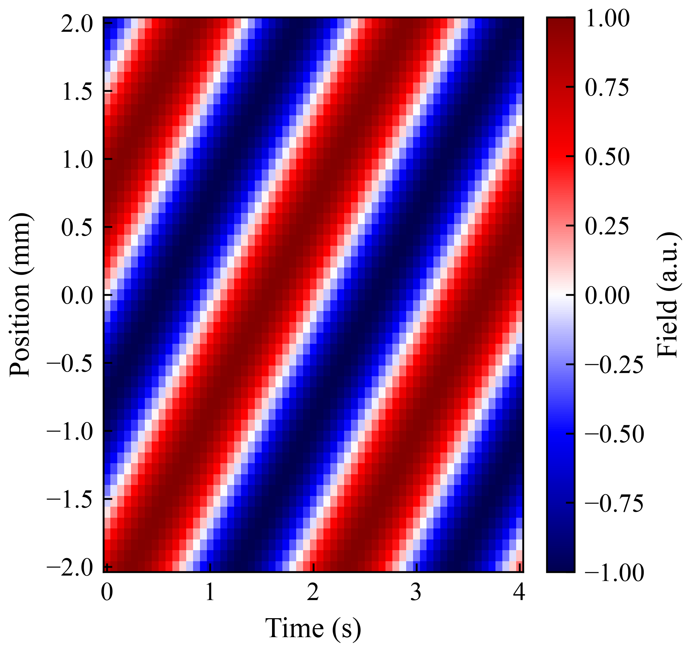](assets/showcase/space-time.png) | [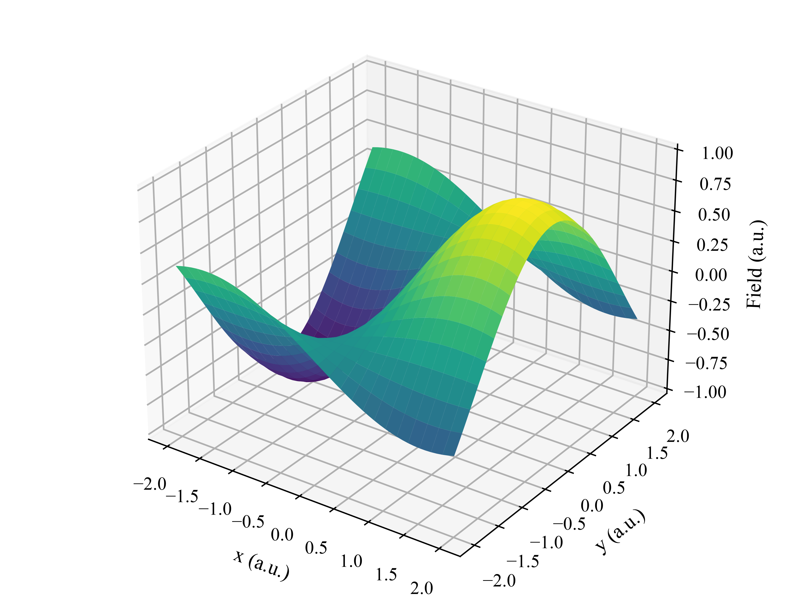](assets/showcase/surface-3d.png) | [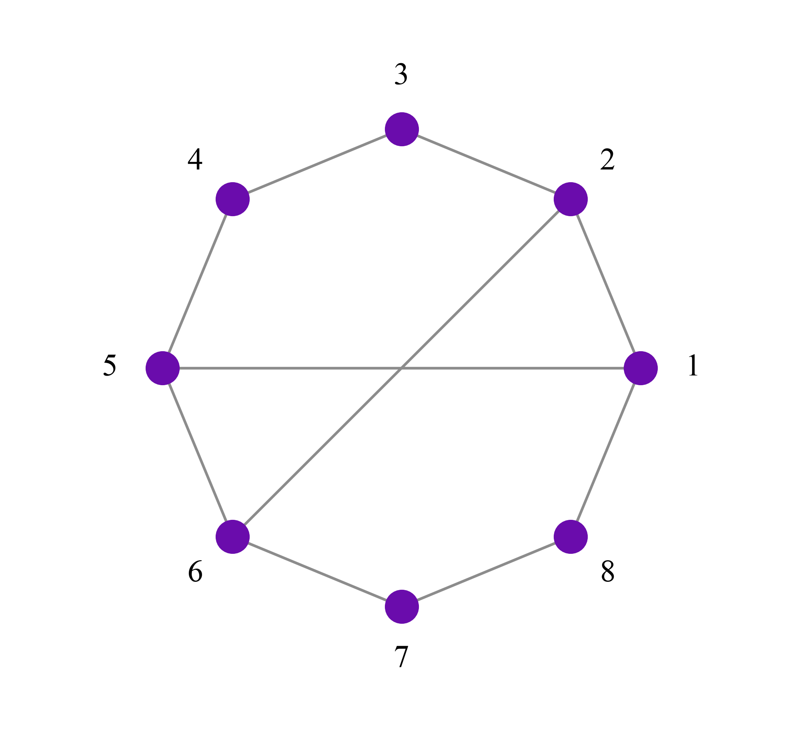](assets/showcase/network.png) |

对比图和图型示例使用合成数据。[查看全部图型与生成方法](references/figure-families.md)。

**Fig. 1：流程图与科学示意图**

[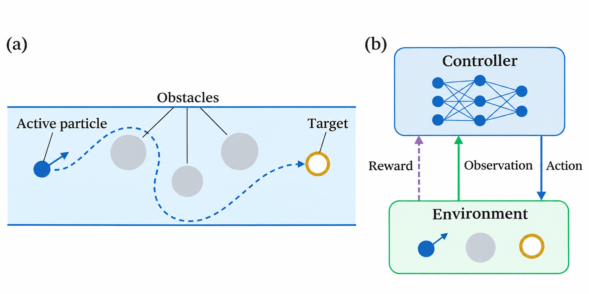](assets/examples/model-first-schematic/fig1-model.png)

内置绘图模型生成 PNG，再重建可编辑 PPT。[下载 PPT](assets/examples/model-first-schematic/fig1.pptx) · [查看实际渲染](assets/examples/model-first-schematic/fig1.preview.png) · [制作方法](references/schematic-image-pptx.md)。上图为原创概念示意。

## 能做什么

主入口 `prl-style` 可组合完成任务，也可直接调用以下 8 个子 skill。

| 入口 | 功能 |
| --- | --- |
| `$prl-figures` | 数据绘图与修改，调整配色、布局、字体、坐标轴和图例。 |
| `$prl-schematics` | 生成 Fig. 1、模型示意和流程图，交付 PNG 与可编辑 PPT。 |
| `$prl-writing-en` | 英文论文起草、润色、压缩与结构调整。 |
| `$prl-writing-zh` | 中文科研稿件撰写与修改。 |
| `$prl-bilingual` | 中英互译与术语、数值、结论一致性检查。 |
| `$prl-captions` | 根据图片与研究说明生成中英文图注。 |
| `$prl-review` | 审核图件、图注、正文与排版。 |
| `$prl-evidence` | 查询文献依据，维护参考库。 |

写作规则来自 100 篇 PRL 论文，主要涉及粒子运动、活性粒子和强化学习。

## 安装与接入

### 一句话安装

将下面这句话复制给支持联网和本地命令执行的 agent：

```text
请从 https://github.com/tysun1209/prl-style 的最新 Release 下载完整发布包，按 README 安装主 skill 和全部 8 个子 skill 到当前 agent 的用户级技能目录，并检查文件完整性和技能是否可用。
```

### 安装后调用

| Agent | 手动安装参数 `--agent` | 调用主入口 |
| --- | --- | --- |
| Codex | `codex` | `$prl-style` |
| Claude Code | `claude-code` | `/prl-style` |
| OpenCode | `opencode` | `@prl-style` |
| DeepSeek Harness | `deepseek-harness` | `/prl-style` |

子 skill 使用同样的前缀，如 `$prl-figures` 或 `/prl-writing-en`。未显示时重启 agent，并确认安装在实际运行的机器和用户目录下；完整名称为 `prl-style`，没有独立的 `prl` 别名。

<details>
<summary>手动安装、更新与运行环境</summary>

下载并解压[最新完整发布包](https://github.com/tysun1209/prl-style/releases/latest)，在包含 `install.py` 的目录执行（Python 3.10+）。以下以 Codex 为例，其他 agent 替换为上表中的参数：

```bash
python3 scripts/verify_package.py
python3 install.py --agent codex
python3 install.py --agent codex --check
```

一次安装主入口和全部 8 个子 skill；更新时用新发布包重复执行。`--check` 检查安装文件，是否能调用需在 agent 中确认。

- 默认目录：Codex 为 `~/.agents/skills`，Claude Code 为 `~/.claude/skills`，OpenCode 为 `~/.config/opencode/skills`，Harness 为 `~/.dsh/skills`。
- OpenCode 尊重 `XDG_CONFIG_HOME`，Harness 尊重 `DSH_HOME`；其他目录或 agent 使用 `--destination PATH` 指定技能父目录。
- 安装后技能资源独立保存，更新会备份旧版；运行脚本的 Python 环境需保留。
- 仓库和下载包只存一套共享资源；请从根目录运行安装器，不要单独复制 `subskills/` 下的目录。

需要绘图或运行检查脚本时，准备并使用以下环境：

```bash
python3 -m venv .venv
.venv/bin/python -m pip install -r requirements.txt
```

纯文字任务无需绘图库；编译论文 PDF 需要 LaTeX。示意图需要宿主内置生图工具与 python-pptx，PPT 渲染可用 PowerPoint 或 LibreOffice。

以上命令适用于 Linux/macOS。Windows 可用 `python -X utf8`，虚拟环境路径为 `.venv\Scripts\python.exe`，尚未实测。没有技能发现功能的 agent，可直接读取包内 `SKILL.md`。

</details>

完整工作流主要在 Codex 中验证；其他 agent 已验证安装目录与脚本运行。版本见 [VERSION](VERSION)，分发与验证范围见 [NOTICE.md](NOTICE.md)。

## 怎么使用

提供文件并说明想要的结果即可。以下使用 Codex 的 `$` 写法，其他 agent 替换为上表中的前缀。

| 任务 | 示例提示 |
| --- | --- |
| 绘图与图注 | `$prl-style 根据 results.csv 和 data-notes.md 绘制曲线对比图，自动选色，输出单栏 PNG、代码和英文图注。` |
| Fig. 1 示意图 | `$prl-schematics 根据 model.md 绘制模型示意图，生成 PNG 和可编辑 PPT。` |
| 英文润色 | `$prl-writing-en 精简 draft.tex 的摘要和结果，保留数值、引用与结论适用范围。` |
| 中文写作 | `$prl-writing-zh 根据 results.md 和 figures/ 撰写中文结果部分，围绕物理发现组织段落。` |
| 图片生成图注 | `$prl-captions 根据 figure1.pdf 和 methods.md 撰写中英文图注，列出待补充信息。` |
| 中英核对 | `$prl-bilingual 核对 manuscript-zh.md 与 manuscript-en.tex 的术语、数值和结论，润色英文。` |

绘图请附数据列、单位和误差定义；写作请附已有结果、参考文献和篇幅要求。字体、配色、尺寸与格式都可另行指定。

## 默认风格

- **输出：** 数据图默认 **600 dpi PNG**；PDF、EPS、SVG 按需保存。示意图交付模型生成的 PNG 与重建的可编辑 PPTX，PNG 分辨率按原生像素核查。
- **字体：** 英文与数字用 Times New Roman，中文用宋体（SimSun）；导出需本机具备字体，聊天和 Markdown 字体由客户端决定。
- **布局：** 图例优先放在图内空白处，多面板对齐并压缩留白；刻度朝内，上侧与右侧刻度按面板选择；解释性小字放到图注中。
- **配色：** 按图型、数据含义、对象数量与背景自动选色，同一对象跨面板同色；用户指定的颜色优先。
- **写作：** 保留事实、适用条件与证据强度，直接表达结果，减少重复限定与套话。

本项目为独立工具，投稿要求以 PRL 官方指南为准。

## 进一步使用

- [配色选择与 Python 调用](references/prl-color-palettes.md)
- [图型目录与示例生成](references/figure-families.md)
- [英文写作指南](references/writing-en.md) · [中文写作指南](references/writing-zh.md)
- [图注写作指南](references/caption-writing.md)
- [给代理使用的完整指令](SKILL.md)
