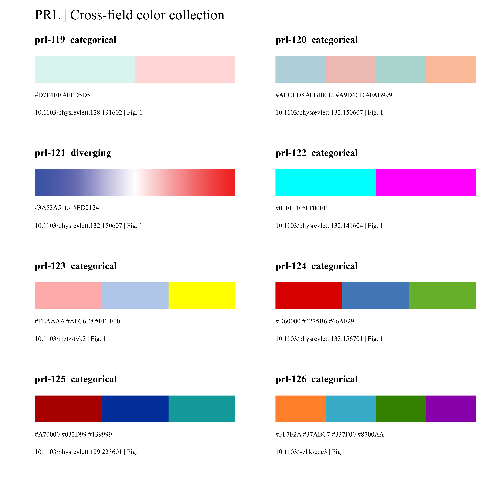

# 近五年跨领域图形设计

新增 50 篇公开可获取的 PRL 研究论文，按 2022—2026 年与 10 个检索领域选取，每篇检查了 Fig. 1。领域包括量子信息、原子分子、凝聚态、磁性、光学、粒子核物理、引力、等离子体、流体和软物质；交叉论文可跨领域使用。完整记录见[逐篇来源与观察](crossfield-sources.json)，构图索引见[14 种构图方式](../profiles/crossfield-visual-patterns.json)。

这些是具体任务可借鉴的设计，不是整个期刊的采用比例。它们补充现有 36 类基础图型；原有 100 篇写作参考不因此变成 150 篇写作语料。

## 先选择表达任务

| 需要解释的内容 | 构图方式与要点 | 来源例子 |
| --- | --- | --- |
| 多通道量子操作 | `quantum_circuit`：线路平行、门跨度明确，重复单元与测量端分开 | X003、X005、X016 |
| 光学器件与探测 | `optical_train`：连续光路贯穿器件；探测和控制返回分路 | X002、X007、X022、X024 |
| 观测与控制 | `feedback_control`：分别标明输出和返回，模块内部形状说明其作用 | X004、X022 |
| 粒子相互作用 | `interaction_vertices`：传播线、顶点、方向和切割拓扑先核准 | X028、X030、X035 |
| 晶格、自旋和局部耦合 | `lattice_spin`：重复阵列作背景，关键键、缺陷或纹理突出 | X008、X011、X018、X021 |
| 曲面与抽象投影 | `geometry_projection`：空间图与复平面／单位胞图沿用身份色 | X001、X012、X014、X017 |
| 连续介质与微观组成 | `continuum_inset`：主图交代边界，局部放大解释组成与界面 | X046、X047 |
| 形变、制备或状态转换 | `state_sequence`：用姿态和分支说明过程，保持时间／参数顺序 | X048、X049 |
| 装置、机制与结果 | `apparatus_evidence`：装置示意、真实照片、数值图分区生成 | X003、X007、X019、X047 |
| 参数切片或多个物理量 | `parameter_slices`：对齐绘图区，保持对象和选点映射 | X006、X009、X025、X040、X050 |
| 同步谱图与时序 | `aligned_panels`：共享横坐标，独立量纲，压缩不必要间距 | X026、X039 |
| 主谱与相对偏差 | `aligned_ratio`：主谱较高、比值行较低；定义真实分母 | X029 |
| 约束与稳定性 | `exclusion_limits`：边界、填色方向与统计／稳定定义分别说明 | X027、X036 |
| 粒子与背景场 | `particle_transport`：颜色加符号区分粒子，场和轨迹分层 | X032、X045 |

这些名称是检索标签，不要求把所有图改成同一套模板。X017 的极简单位胞、X005 的黑白线路和 X031 的直接结果图都说明：Fig. 1 的信息需要决定其形式。

## 如何调用

示意图任务先选相关构图，再使用[内置图像模型 → 可编辑 PPT](schematic-image-pptx.md)流程：

```bash
python scripts/select_crossfield_references.py --pattern quantum_circuit --limit 3
python scripts/select_crossfield_references.py --pattern optical_train --limit 3
python scripts/select_crossfield_references.py --family heatmap --field plasma_fusion
python scripts/prl_palette.py --query 光机
```

检索返回页码、DOI、具体观察、适用方式和反例。开发环境有原文时返回核验哈希后的本地路径；分发包仅保留来源定位与归纳。原有校准参考继续由 `select_references.py` 检索，两者的评估用途独立。

为模型生成提示词时，将选中规则落实为**对象、布局和连接约束**。例如量子线路要列出每条线、门作用范围和测量端；光路要列出器件顺序、分束去向及反馈端点；力学剖面要列出边界与位移方向。不要只写“模仿 PRL”或把论文题目当作提示词。

## 把风格落实到细节

- **颜色按角色跨图延续。** X024 在器件图和时空图中沿用输入／输出色；X050 的曲线与选点同色，但区域填色另有模态组合含义。两套编码要分别定义。调用[配色库](prl-color-palettes.md)，不要凭外观猜颜色代表的量。
- **线型承担科学含义。** X048 的稳定与不稳定分支、X030 的切割线、X021 的损耗线都不能在美化时随意合并。将方向、连接和线型写入重建对象的含义。
- **放大图有明确对象。** X010 放大能阱，X046 放大组成，X047 放大接触几何。放大框与插图的关联应可读；三者不能都当成定量局部曲线。
- **对齐看实际绘图区。** X029 的主谱与比值行、X040 的相同时刻截面需要可比较的边缘与尺度。色标预留独立空间；固定长宽比结束布局后再检查间距。
- **刻度逐面板决定。** 数据图延续朝内默认，上／右侧按可读性选择；无数值坐标的示意图不加装饰性刻度。X017 的向量坐标也不是数据图四边坐标轴。
- **标签接近对象，说明留给图注。** 端口、粒子身份和尺寸是必要标签；源图里较长的标题或解释段落不自动继承。保留本 skill 默认无图内小字说明。

## 重建成 PPT 时的重点

| 构图 | 必须保留为可编辑对象的部分 | 需要额外核对 |
| --- | --- | --- |
| 量子线路／算符网络 | 每条通道、每个门框、端口、重复单元与标签 | 门跨度、交叉与连接点、测量顺序 |
| 光路／反馈 | 器件轮廓、光束边界、控制线与文字 | 反射／分束方向、控制信号不混成光束 |
| 相互作用图 | 独立传播路径、顶点、切割线和粒子标签 | 连通拓扑、箭头和线型约定 |
| 连续介质／放大 | 主边界、材料层、尺寸箭头、引线与局部结构 | 接触关系、形变方向、局部与整体对应 |
| 状态序列／混合 Fig. 1 | 概念形状、时间箭头、面板 ID 与标签 | 实验照片保留原始栅格，数据图保持真实数据 |

复杂电子密度、照片或体渲染可以是独立位图对象，内部像素不称为可编辑几何。完成后检查实际 Office 渲染中的连线、字形、遮挡和留白。默认仍交付模型 PNG、可编辑 PPTX、图注与重建源；数据图默认 PNG、600 dpi。

## 新色卡

本轮新增 16 组经过图像复核的配色，来自 15 张图；另有 1 张图的候选色标因低端处理不明确未采用。总库为 133 组。近似 RGB 值取自出版图件，不是作者原始作图参数。

[](../assets/showcase/crossfield-palettes-1.png)

[第二页色卡](../assets/showcase/crossfield-palettes-2.png) · [全部配色的检索图册](../reports/prl-colors-2025-2026/index.html)

原 117 组配色的 ID 和颜色保持不变。新的条件观察、图型匹配与色卡由 agent 查看图像后归纳；尚未做新增跨领域任务的独立盲评。
